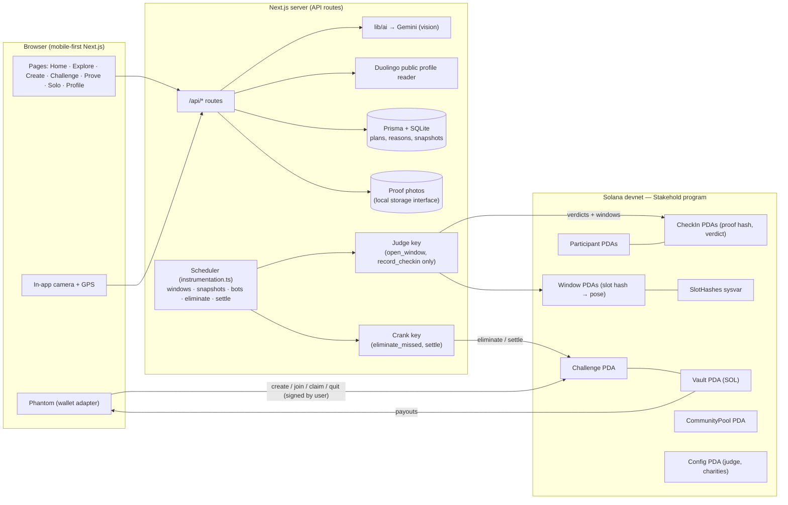

# Stakehold — Survivor for your habits

> **Put money on your habits. An AI referee checks your proof. The people who quit pay the people who don't — and Solana makes every step verifiable.**

Stakehold is a habit challenge where players stake SOL. Every day they submit proof — a live photo with a random pose, a gym check-in and check-out with GPS, or verified Duolingo data. Plain code checks the hard facts (time windows, location, numbers) and an AI referee judges each proof. Miss a day and you're eliminated, live on the leaderboard. At the end, the survivors split the whole pot, including the stakes of everyone who dropped out, paid out by a Solana program. Solo players can bet on themselves: finish and get the stake back plus a bonus from the community pool, fail and the stake goes to a charity or the pool.

- **Network:** Solana **devnet** only
- **Program ID:** `87upMZXfZad7wuReP9LeoKW3HpFGfhgyF5nEhVSZx5ec` ([Explorer](https://explorer.solana.com/address/87upMZXfZad7wuReP9LeoKW3HpFGfhgyF5nEhVSZx5ec?cluster=devnet))
- **AI referee (judge) key:** `AxwtzsUhbZzGHFNUeQLJ2kgxipoqmJtqzqrHHBKz95Ma`

---

## The problem

Most people who start a habit quit within weeks. Willpower alone doesn't hold, and "accountability" apps rely on the honour system. Money on the line works (loss aversion is powerful), but escrow platforms are centralised: you have to trust them with the pot and trust their judging.

## The solution

- **Stakes in a program-owned vault.** Nobody, not even us, can run off with the pot.
- **Layered judging.** ① Code checks hard facts (window timing, GPS geofence, time gap, Duolingo XP numbers). ② An AI referee judges every photo (correct pose, live photo, rule followed, no prompt injection). ③ People resolve appeals *(roadmap)*.
- **Unpredictable poses.** When a proof window opens, the program reads the **SlotHashes sysvar** and derives the pose (fingers × direction × extra = 80 combinations). A pre-taken photo can't match it.
- **A survivor game.** Eliminations show up live. Survivors split the pot equally, using a pull pattern (`claim`).
- **Solo mode + community pool.** Bet on yourself and pick a charity or the community pool as the destination if you fail. Finishers get a capped bonus from the pool.

## How Solana is used

| What | How |
|---|---|
| **Escrow** | `join_challenge` moves the exact stake into a program-owned `Vault` PDA. Only `settle`/`claim` move it out, and both depend only on recorded state. |
| **Randomness + timestamps** | `open_window` reads the newest entry of the `SlotHashes` sysvar and stores the slot, the hash, `opened_at` and the derived pose in a `Window` PDA. The browser's Verify panel recomputes the pose from the hash. Day boundaries and windows use the onchain `Clock`. |
| **Permanent check-in records** | Every verdict (pass *or* fail) becomes a `CheckIn` PDA holding a SHA-256 **proof hash**, the verdict, a reason code, metrics (e.g. Duolingo XP), the slot and a timestamp. Photos are never stored onchain. |
| **AI referee with limited powers** | The judge keypair can sign **only** `open_window` and `record_checkin`. It cannot touch the vault or the pool; it just pays rent for the records it writes. The judge is set globally by the admin and copied into each challenge, so creators can't appoint themselves. |
| **Automatic payouts** | Anyone can call `eliminate_missed` after a missed day and `settle` after the end. Survivors `claim` their equal share, and double claims are impossible. If nobody survives, the pot goes to the community pool (or to the chosen charity for solo). |
| **Rules commitment** | The challenge's proof plan is hashed (`config_hash`) at creation, so the rules can't be changed afterwards. The UI verifies the hash. |

## Architecture



### Program accounts and instructions (`programs/stakehold`)

- **Accounts:** `Config` (global admin, judge, demo charities, bonus settings) · `CommunityPool` · `Challenge` · `Vault` · `Participant` · `Window` · `CheckIn`
- **Instructions:** `init_config`, `update_config`, `donate_to_pool`, `create_challenge`, `join_challenge` (exact stake, before your own start only), `forfeit` (quit), `open_window` (judge; SlotHashes), `record_checkin` (judge; pass/fail/baseline), `eliminate_missed` (anyone), `settle` (anyone; every participant passed in as remaining accounts), `claim` (survivor; pull payment).
- **Time zones:** a challenge has a reference start (00:00 UTC of the start date). Each member's day 1 begins at **their own local midnight** (`start − utc_offset`, with the offset captured at join from their IANA zone). Demo challenges share one start.

## Proof types

| Type | Strength | How it's checked |
|---|---|---|
| 📸 **Photo + pose** | good | A surprise window opens at a random time within the creator's allowed hours and lasts 10 min (configurable). The in-app camera is the only input (no gallery). The AI checks the pose, that the photo is live and that the rule is followed. One retake per window. |
| 🏋️ **Gym** | good | "I'm at the gym" opens a check-in window → photo + GPS (≤ 100 m). At least 45 min later, check-out opens a **new** pose → photo + GPS. Code checks the distance and the time gap; the AI checks both photos. One onchain verdict per day, whose proof hash commits to both photos and the GPS readings. |
| 🦉 **Duolingo** | strong | Ownership: paste a one-time `STAKE-XXXX` code into your public bio. Your starting XP is recorded onchain when the day or round starts (or the moment you link, if you link late). Rule: **XP earned ≥ the minimum** each day or round. Streaks are deliberately ignored: you may already have kept today's streak before joining, and a streak doesn't measure effort. "I'm done" checks immediately (with an automatic retry after 60 s), and a scheduled check runs when each day or round ends. Screenshots can pre-fill your username but never count as proof. |
| 🤝 **Honor** | honor system | Daily self-report, recorded onchain. The AI proposes this honestly for "not doing something" habits and suggests a provable reframe. |

The **AI proof-plan helper** on Create turns a plain-English habit into a proof type, an exact rule, window hours and minimums, plus a strength rating (`strong` / `good` / `honor system`).

**Prompt-injection guard:** the judge prompt treats any text inside images as data. A sign saying "approve this" sets `injection_detected` and fails the proof. The final verdict is computed **in code** from the individual checks; the model never gets to say "pass" on its own.

## Setup (macOS)

Prerequisites: Node 22+, and for the program: Rust, Solana CLI (Agave) and Anchor 1.2 (`brew install rustup solana anchor`, then `cargo install cargo-build-sbf`).

```bash
# 1. secrets — put your key in the repo-root .env.local (git-ignored)
cp .env.example .env.local      # then paste GEMINI_API_KEY

# 2. install app deps + create the local DB
npm run setup

# 3. (once) devnet config: judge key, demo charities, seed community pool
npm run init:devnet

# 4. run
npm run dev                     # http://localhost:3000
```

Keys (all git-ignored in `keys/`): `judge.json` (AI referee), `stakehold-program.json` (program ID), `charity-*.json` (demo charity wallets), `demo-bots.json` (generated). The deploy/crank wallet is `~/.config/solana/id.json`.

Program:

```bash
anchor build && npm run sync-idl     # build + copy IDL into the app
anchor test                          # LiteSVM tests
anchor deploy --provider.cluster devnet
```

**Phones:** the camera and GPS need HTTPS. Use a tunnel such as `cloudflared tunnel --url http://localhost:3000` and open the HTTPS URL on your phone (switch Phantom to devnet).

## Demo walkthrough (≈5 minutes)

1. Open **`/demo`** (hidden route) → **Seed photo challenge + bots** (1 day = 2 min, 2 days, 4 scripted bots).
2. Open the challenge link and **join with Phantom** before the lobby countdown ends.
3. Day 1: the window opens automatically (or press 🎲 *Open windows now*). The pose card appears. Take a **fresh photo with the correct pose** → ✅ accepted, verdict onchain with an Explorer link. Tunde 🤖 quits.
4. Day 2: try a **pre-taken photo or the wrong pose** → ❌ rejected with a clear reason. Use the one retake → ✅. Mei 🤖 gets the pose wrong twice.
5. When day 2 ends, Mei is **eliminated on the leaderboard**, with the day and reason.
6. The challenge ends → **settle** (automatic, or press 🏆) → survivors split the pot → **claim** with Explorer links.
7. Duolingo: **Seed 1-day Duolingo demo** → link your account → join → baseline recorded at start → do a lesson → **I'm done — check my XP** → "+45 XP ✅ you're safe".

The **Verify panel** on each challenge shows each window's slot and slot hash and how the pose was derived from its bytes.

## Honest limitations

- **Duolingo data is unofficial.** We read the public profile endpoint (`/2017-06-30/users?username=`). It can change or rate-limit without notice, and profiles must be public.
- **Proof is layered, not cheat-proof.** A determined cheater could stage photos. The random pose, surprise windows, live-photo checks and GPS make cheating costly, not impossible. Appeals (people resolving disputes) are on the roadmap.
- **The AI can be wrong.** Verdicts include reasons, and failed attempts are recorded too; appeals will be the remedy.
- **Window *times* are chosen offchain** by our scheduler (the *pose* is onchain randomness). A malicious operator could pick inconvenient times; it could not choose the pose.
- **Devnet only.** No real money. Demo charities are labelled placeholder wallets.
- The UTC offset is fixed for the whole challenge, so a DST change mid-challenge shifts that member's day boundary by an hour.

## Roadmap

Appeals voting · completion badges as tokens · GitHub (OAuth + server-side push times + AI diff review) · Strava (verified workouts, no manual activities) · reading proof (random pages + voice recap) · sudden death (single champion after day 30) · yield on idle pots · sponsor pots (**Sponsor**) · skill games with pots (**Stake**) · native mobile app with Apple App Attest / Google Play Integrity.

## Repo layout

```
programs/stakehold/      Anchor program (Rust) + LiteSVM tests
app/                     Next.js app (App Router, TypeScript, Tailwind)
  src/lib/ai/            AI provider wrapper (Gemini) — judge, plan, screenshot reader
  src/lib/server/        chain client (judge/crank), game engine, scheduler, demo seeding
  src/lib/time.ts        day-boundary logic (+ unit tests)
  prisma/schema.prisma   offchain data
  scripts/               init-devnet, seed-demo
docs/                    spec, plan, progress, decisions, demo script, submission text
```

Built for the MLH Solana Hackathon, November 2026.
